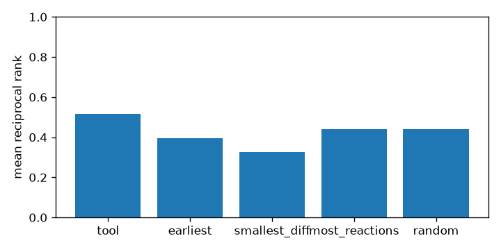

# Study: does pr-triage rank the PR a maintainer merged first?

## Question

When a bounty issue draws several pull requests, does pr-triage put the one the maintainer merged at rank 1, and does it beat simple orderings?

## Data

Collected 2026-11-16T02:34:55+00:00 with pr-triage 0.1.0. Method: GitHub search label:bounty in the orgs above; linked PRs = timeline cross-referenced pull requests, any state, any repo.
Issues seen 77; kept 27 with at least two linked PRs (167 PRs); 24 with exactly one merged PR form the evaluation set; 49 below the two-PR minimum.

- Excluded hanzo-go/lz4#1: the author's own PR (#22) competes on this issue; excluded for conflict of interest.

Published data are references, hashes and derived check values only; contributors' text stays out of this repository.

## Method

Deterministic checks always run; Kai checks are advisory and run only with a key. A PR's score is the weighted share of evaluated checks it passes; ties are broken uniformly at random for the tool and every baseline alike (expected reciprocal rank and expected top-1). Baselines: random order (exact expectation), earliest PR first, smallest diff first, most reactions first. Weights are fitted by leave-one-issue-out coordinate search on mean reciprocal rank.

Weights used for the headline numbers: `0-unfitted-models-off`. Kai calls: 14 (637.92 micro-USD).

## Results

| Ordering | Top-1 | MRR | Issues |
|---|---:|---:|---:|
| pr-triage | 0.26 | 0.51 (95% CI 0.44-0.58) | 24 |
| earliest | 0.12 | 0.40 | 24 |
| smallest_diff | 0.08 | 0.33 | 24 |
| most_reactions | 0.20 | 0.44 | 24 |
| random | 0.20 | 0.44 | 24 |



Leave-one-issue-out MRR with fitted weights: 0.55. Fitted weights: addresses_issue 0.5, ci_state 2, claim_vs_diff 0, criteria_static 1, duplicate_of 1, effort 1, hidden_text 1, injection 1, payment_request 1, residue 1, scope_creep 1, touches_target 1.

Kai controls: planted/pos FAIL, planted/neg pass, addresses_issue/pos pass, addresses_issue/neg pass, effort/pos pass, effort/neg FAIL.

Per-check agreement with manual labels: see `calibration.json`.

## Diagnosis

Ranking by the manual labels themselves (addresses the issue, no scope creep, no unsupported claims) gives top-1 0.34 and MRR 0.58. Labelled acceptable: 23/24 merged PRs and 83/122 of the others. When several competing PRs are acceptable, which one a maintainer merges depends on things these checks do not measure, so merge order is a weak target for a quality ranker.

| Check | Pass rate, merged | Pass rate, not merged |
|---|---:|---:|
| addresses_issue | 19/24 | 94/122 |
| ci_state | 24/24 | 108/108 |
| claim_vs_diff | 23/24 | 119/120 |
| duplicate_of | 23/24 | 109/122 |
| effort | 24/24 | 122/122 |
| hidden_text | 24/24 | 122/122 |
| injection | 24/24 | 122/122 |
| payment_request | 22/24 | 96/122 |
| residue | 24/24 | 122/122 |
| scope_creep | 12/17 | 51/92 |
| touches_target | 13/17 | 51/92 |

Checks that never failed on this data (they cannot separate PRs here): ci_state, effort, injection, residue.

## Errors

- hanzoai/agents#10: merged #55 not uniquely first (pessimistic rank 7, tied with 6); failed checks on it: scope_creep, touches_target.
- hanzoai/agents#6: merged #23 not uniquely first (pessimistic rank 4, tied with 1); failed checks on it: duplicate_of.
- hanzoai/agents#7: merged #48 not uniquely first (pessimistic rank 5, tied with 4); failed checks on it: addresses_issue.
- hanzoai/agents#8: merged #25 not uniquely first (pessimistic rank 7, tied with 6); failed checks on it: none.
- hanzoai/agents#9: merged #36 not uniquely first (pessimistic rank 9, tied with 2); failed checks on it: addresses_issue, payment_request, scope_creep, touches_target.
- hanzoai/ai#130: merged #152 not uniquely first (pessimistic rank 4, tied with 3); failed checks on it: none.
- hanzoai/ai#131: merged #151 not uniquely first (pessimistic rank 2, tied with 1); failed checks on it: addresses_issue.
- hanzoai/ai#132: merged #183 not uniquely first (pessimistic rank 3, tied with 2); failed checks on it: none.
- hanzoai/ai#134: merged #141 not uniquely first (pessimistic rank 4, tied with 2); failed checks on it: payment_request.
- hanzoai/ai#136: merged #184 not uniquely first (pessimistic rank 3, tied with 2); failed checks on it: none.
- hanzoai/ai#137: merged #161 not uniquely first (pessimistic rank 4, tied with 3); failed checks on it: none.
- hanzoai/ci#12: merged #21 not uniquely first (pessimistic rank 2, tied with 1); failed checks on it: none.
- hanzoai/ci#13: merged #26 not uniquely first (pessimistic rank 3, tied with 2); failed checks on it: none.
- hanzoai/cli#11: merged #15 not uniquely first (pessimistic rank 2, tied with 1); failed checks on it: none.
- hanzoai/cli#12: merged #23 not uniquely first (pessimistic rank 3, tied with 2); failed checks on it: none.
- hanzoai/mcp#14: merged #16 not uniquely first (pessimistic rank 5, tied with 4); failed checks on it: scope_creep.
- hanzoai/orm#6: merged #16 not uniquely first (pessimistic rank 4, tied with 3); failed checks on it: none.
- hanzoai/orm#7: merged #13 not uniquely first (pessimistic rank 4, tied with 3); failed checks on it: none.
- hanzoai/orm#8: merged #17 not uniquely first (pessimistic rank 4, tied with 3); failed checks on it: none.
- hanzoai/sqlite#3: merged #5 not uniquely first (pessimistic rank 4, tied with 3); failed checks on it: none.
- hanzoai/sqlite#4: merged #14 not uniquely first (pessimistic rank 5, tied with 4); failed checks on it: none.
- hanzoai/ui#257: merged #267 not uniquely first (pessimistic rank 8, tied with 2); failed checks on it: addresses_issue, claim_vs_diff, scope_creep, touches_target.
- hanzoai/ui#258: merged #263 not uniquely first (pessimistic rank 2, tied with 1); failed checks on it: addresses_issue, scope_creep, touches_target.
- hanzoai/vfs#29: merged #35 not uniquely first (pessimistic rank 2, tied with 1); failed checks on it: none.

## Limits

One organisation's bounty program; a small number of issues; maintainers' merge decisions are the ground truth, and they can merge for reasons no check sees. Manual labels, where used, are made by an assistant from a written rubric and spot-checked by the author. Kai results are model opinions. Labels were made blind (no tool output, no merge status) by a separate assistant session from study/RUBRIC.md; the author spot-checked 20 random PRs (seed 0) and agreed on 59/60 labels (98.3%) before correcting the one disagreement.

## Reproduce

```
python study/build_dataset.py --raw <private dir>   # or reuse a saved raw snapshot
python study/run_study.py --raw <private dir>      # replays; without --raw it re-fetches and reports drift
```
